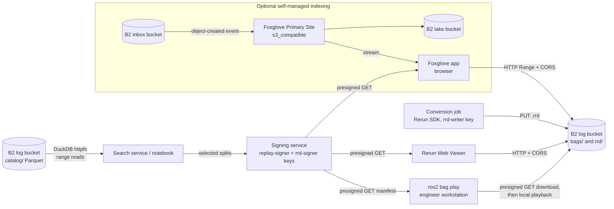

# Search, visualize and replay fleet sessions from the log lake

## Workload

Robotics engineers triage field issues, review autonomy behavior and pull sessions for labeling. They need to find the right ten minutes across thousands of robot-days, open it in a viewer, and replay it locally, without bulk-downloading terabytes. This architecture reads the log lake that [robot-log-offload](../robot-log-offload/architecture.md) writes.

## Data flow



1. `catalog/` holds one Parquet row per session or split: robot, time range, topics, ROS distribution and tags.
2. DuckDB queries the catalog in place with range reads and returns object keys.
3. A signing service mints short-lived presigned GETs for those keys.
4. The Foxglove app opens each MCAP over HTTP range requests; the Rerun Web Viewer loads `.rrd` recordings from presigned URLs; for `ros2 bag play`, the workstation downloads the splits from a presigned GET manifest and plays them locally, as in the Rosbag2 Cloud Offload sample.
5. Optionally, a self-managed Foxglove Primary Site ingests from a B2 inbox bucket into an indexed B2 lake bucket and streams sessions to the Foxglove app.

`.rrd` files are optional and are not written by robot-log-offload. A conversion job you own reads selected sessions, logs the topics you want with the Rerun SDK, saves an `.rrd`, and writes it under `rrd/<robot>/<session>/` with the `rrd-writer` key. Skip the `rrd/` zone if you do not use Rerun.

## B2 zones

| Zone | Bucket and prefix | Versioning and lifecycle | Object Lock | Purpose |
|---|---|---|---|---|
| Session catalog | `<org>-robot-logs/catalog/` | Owned by [robot-log-offload](../robot-log-offload/architecture.md) | No | Parquet index queried in place |
| Raw splits | `<org>-robot-logs/bags/<robot>/<session>/` | Owned by robot-log-offload | No | MCAP read by range requests |
| Rerun recordings | `<org>-robot-logs/rrd/<robot>/<session>/` | Same windows as raw splits ([lifecycle-log-lake.json](../../examples/lifecycle-log-lake.json)) | No | `.rrd` files written by the conversion job for the Rerun Web Viewer |
| Primary Site inbox (optional) | `<org>-foxglove-inbox/` | Short; Primary Site moves data to the lake | No | Upload target that triggers indexing |
| Primary Site lake (optional) | `<org>-foxglove-lake/` | Managed by Primary Site | No | Indexed recordings served to Foxglove |

## Boundaries

| Stays off B2 | Where it lives | Why |
|---|---|---|
| Live search and tag index | Postgres, ClickHouse, or the Primary Site index database | Low-latency queries and updates |
| Viewer UI state and user auth | Foxglove, Rerun, or your identity provider | Per-user sessions |
| Hot replay cache | Local NVMe on workstations or replay hosts | Repeated reads of the same session |
| Live robot streams | Foxglove bridge / ROS graph | Real-time data, not archived objects |

## B2 capability map

| Capability | Used | How |
|---|---|---|
| S3-compatible API | Yes | DuckDB, signing service, Primary Site |
| Range GET | Yes | DuckDB Parquet reads, Foxglove MCAP seeks; `ros2 bag play` downloads splits whole |
| Presigned URLs | Yes | GET only, short TTL |
| Bucket CORS | Yes | `s3_get` and `s3_head` for viewer origins ([cors-viewers.json](../../examples/cors-viewers.json)) |
| Scoped application keys | Yes | Read-only, restricted to `bags/`, `rrd/` or `catalog/` (one prefix per key); `rrd-writer` for the conversion job |
| Included egress | Yes | Repeated range reads by viewers and replay; see [B2 pricing](https://www.backblaze.com/cloud-storage/pricing) for terms |
| Event Notifications | Only with Primary Site | Inbox object-created events; Backblaze Support must enable the feature |
| Object Lock, replication | Not used | Evidence locking lives in robot-log-offload |
| Overdrive | Rarely | Interactive reads are latency-bound; consider it only for sustained bulk re-processing of the lake |
| Local cache | Yes | NVMe cache for sessions replayed repeatedly |

## Integration configuration

### DuckDB (httpfs)

Documented S3 secret with a custom endpoint:

```sql
CREATE SECRET b2 (
  TYPE s3,
  KEY_ID '<from env>', SECRET '<from env>',
  ENDPOINT 's3.<region>.backblazeb2.com',
  REGION '<region>',
  URL_STYLE 'path'
);
SELECT robot, session, start_time FROM read_parquet('s3://<org>-robot-logs/catalog/*.parquet')
WHERE list_contains(topics, '/estop');
```

Use a read-only key restricted to `catalog/`. Load secrets from the environment, never from a committed file. The [DuckDB Query In Place](https://github.com/backblaze-b2-samples/duckdb-query-in-place) sample shows the same pattern against B2.

### Foxglove app (remote files)

Foxglove's [remote file docs](https://docs.foxglove.dev/docs/visualization/connecting/cloud-data) describe opening a file by URL. Requirements stated there: the server must support range requests, must not redirect (redirects break CORS), and must send CORS headers that allow the Foxglove origins and expose the headers it needs. Give Foxglove a presigned GET straight to the B2 object, and apply [cors-viewers.json](../../examples/cors-viewers.json) to the log bucket.

Foxglove's hosted bring-your-own-storage lists AWS, GCP and Azure; for B2, use presigned remote files or a self-managed Primary Site.

### Foxglove Primary Site (self-managed)

The [installation](https://docs.foxglove.dev/docs/primary-sites/installation) and [cloud credentials](https://docs.foxglove.dev/docs/primary-sites/configure-cloud-credentials) pages document `storageProvider: s3_compatible` and `S3_COMPATIBLE_SERVICE_URL`. Set it to `https://s3.<region>.backblazeb2.com` for both the inbox and lake buckets. Primary Site indexes the inbox from object-created notifications, delivered either by provider push or by a POST to the Primary Site `/site-bucket-notifications` endpoint. B2 Event Notifications are webhooks with B2-specific JSON (HMAC-signed, at-least-once), so configure them on the inbox bucket (Backblaze Support enables the feature for the account) and run a small adapter that verifies the B2 signature and POSTs each object-created event to `/site-bucket-notifications`. Make the adapter idempotent, since events can repeat. The [B2 Event Broker](https://github.com/backblaze-b2-samples/b2-event-broker) sample receives and forwards B2 events.

### Rerun Web Viewer

The [WebViewer API](https://ref.rerun.io/docs/js/0.37.0/web-viewer/classes/WebViewer.html) accepts an HTTP URL to an `.rrd` file. Serve it with a presigned GET and add the viewer origin to the CORS rules. For the native viewer, download the `.rrd` by presigned GET and open it locally.

### ros2 bag play

The Rosbag2 Cloud Offload sample generates a presigned GET manifest for a session's splits; the client downloads them and replays them locally with `ros2 bag play`. This is a sample pattern; rosbag2 itself does not read from S3 or HTTP.

## Security

- Viewers receive presigned GETs, never keys. Keep TTLs short; shared links are bearer credentials.
- Restrict CORS to the exact viewer origins and to `s3_get` and `s3_head`. Do not use `*`.
- The DuckDB and signing keys are read-only and restricted to the prefixes they need; only the conversion job's `rrd-writer` key can write `rrd/`.
- Primary Site keys (inbox read and delete, lake write) stay inside the Primary Site deployment.
- Log signing requests by user and session for audit.

## References

- [DuckDB S3 API support](https://duckdb.org/docs/current/core_extensions/httpfs/s3api.html)
- [Foxglove: open remote files](https://docs.foxglove.dev/docs/visualization/connecting/cloud-data)
- [Foxglove Primary Site installation](https://docs.foxglove.dev/docs/primary-sites/installation)
- [Foxglove Primary Site cloud credentials](https://docs.foxglove.dev/docs/primary-sites/configure-cloud-credentials)
- [Rerun WebViewer](https://ref.rerun.io/docs/js/0.37.0/web-viewer/classes/WebViewer.html)
- [Rosbag2 Cloud Offload](https://github.com/backblaze-b2-samples/rosbag2-cloud-offload)
- [B2 CORS rules](https://www.backblaze.com/docs/cloud-storage-cross-origin-resource-sharing-rules)
- [B2 pricing](https://www.backblaze.com/cloud-storage/pricing)
