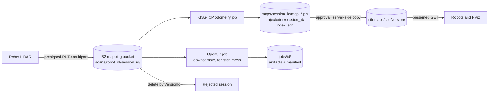

# Archive LiDAR mapping sessions and publish site maps to robots

## Workload

Mobile robots map sites with LiDAR. Odometry and mapping jobs turn scans into poses, trajectories and point-cloud maps. Engineers re-map sites, update localization maps and debug drift, and every task needs the raw scans and all derived artifacts for a session kept together. Volumes reach GB to TB per site. Robots then need the current approved map for their site.

## Data flow

## B2 zones

| Zone | Bucket and prefix | Versioning and lifecycle | Object Lock | Purpose |
|---|---|---|---|---|
| Raw scans | `<org>-robot-mapping/scans/<robot_id>/<session_id>/` | Keep while the site is active | No | Source LiDAR frames |
| Session maps | `<org>-robot-mapping/maps/<session_id>/` and `trajectories/<session_id>/` | Keep with the session | No | KISS-ICP poses, `.ply` maps, trajectories, `index.json` |
| Processing jobs | `<org>-robot-mapping/jobs/<id>/` | Hide after a window, then delete ([lifecycle-scratch.json](../../examples/lifecycle-scratch.json)) | No | Open3D intermediates and previews |
| Site maps | `<org>-robot-mapping/sitemaps/<site>/<version>/` | Never overwritten | Optional | Approved maps served to robots |

`sitemaps/` is a separate prefix from the per-session `maps/` that KISS-ICP writes, so the approval key can be restricted to it.

On B2, `DeleteObjects` without a `VersionId` only hides each file; the bytes stay stored. To remove them, list the prefix with `ListObjectVersions` and delete by `VersionId` (needs `deleteFiles`), or rely on the `daysFromHidingToDeleting` rule in [lifecycle-scratch.json](../../examples/lifecycle-scratch.json), which purges hidden versions under `scans/`, `maps/` and `trajectories/` after a short grace period.

## Boundaries

| Stays off B2 | Where it lives | Why |
|---|---|---|
| Live localization stack and map server | Robot | Real-time pose estimation |
| Spatial index database | PostGIS or similar | Queries by area and time |
| Odometry and meshing scratch | GPU or CPU node disk | Iterative in-memory work |

## B2 capability map

| Capability | Used | How |
|---|---|---|
| S3-compatible API | Yes | PutObject, GetObject, ListObjectsV2, HeadObject, DeleteObjects in the samples |
| Presigned URLs | Yes | PUT for robot uploads, GET for maps and previews |
| Multipart upload | Yes | Large map snapshots and scan bundles |
| Server-side copy | Yes | Promote an approved session map to `sitemaps/` |
| Version-aware deletes | Yes | `ListObjectVersions` plus `DeleteObjects` by `VersionId` for rejected or re-mapped sessions |
| Lifecycle rules | Yes | Expire job intermediates; purge hidden versions under `scans/`, `maps/`, `trajectories/` |
| Scoped application keys | Yes | Signing service, processing jobs and approval each have their own key |
| Event Notifications | Optional | Start odometry when a session's last scan lands |
| Object Lock, replication | Not used | Add only if maps are safety evidence |
| Overdrive | Not needed | Batch processing; site maps are small and cached on the robot |

## Integration configuration

### KISS-ICP

`kiss_icp_pipeline` reads scans from local paths and writes poses (`.npy`, KITTI and TUM text), the run config and a log to a local results directory. Copy a session's scans down, run the pipeline, then sync its results to `trajectories/<session_id>/` with rclone or s5cmd. The [KISS-ICP LiDAR Archive](https://github.com/backblaze-b2-samples/kiss-icp-lidar-archive) sample runs it on the backend and uses boto3 against `https://s3.<B2_REGION>.backblazeb2.com` (PutObject, GetObject, ListObjectsV2, HeadObject, DeleteObjects) with presigned GET and PUT, archiving scans, poses, `.ply` maps and trajectories per session.

### Open3D

Open3D reads and writes point clouds and meshes on local paths ([file IO](https://www.open3d.org/docs/release/tutorial/geometry/file_io.html)). Copy scans down, process them, and sync outputs to `jobs/<id>/` with rclone or s5cmd. The [Open3D Point Cloud Pipeline](https://github.com/backblaze-b2-samples/open3d-point-cloud-pipeline) sample reads PLY, PCD, LAS and LAZ from `raw/`, writes downsampled, registered, meshed and rendered artifacts under `jobs/<id>/` with a JSON manifest, and serves presigned previews. Its endpoint is derived from `B2_REGION`. This architecture maps its `raw/` prefix to `scans/`.

## Security

- Robots upload scans and fetch site maps through presigned URLs minted by a site service; they hold no keys.
- Processing jobs read `scans/` and write only their own derived prefixes.
- Only the approval job writes `sitemaps/`, so robots never load an unapproved map.
- Deleting rejected sessions by `VersionId` needs `deleteFiles`; give it to a separate operator key per prefix, not to the signing service or processing jobs.
- Maps of customer sites can be confidential; scope signing and retention per customer or site, and use a bucket per customer when contracts require isolation.

## References

- [KISS-ICP](https://github.com/PRBonn/kiss-icp)
- [KISS-ICP LiDAR Archive architecture](https://github.com/backblaze-b2-samples/kiss-icp-lidar-archive/blob/main/ARCHITECTURE.md)
- [Open3D](https://www.open3d.org/)
- [Open3D Point Cloud Pipeline architecture](https://github.com/backblaze-b2-samples/open3d-point-cloud-pipeline/blob/main/ARCHITECTURE.md)
- [B2 S3-compatible API](https://www.backblaze.com/docs/cloud-storage-s3-compatible-api)
- [B2 lifecycle rules](https://www.backblaze.com/docs/cloud-storage-lifecycle-rules)
