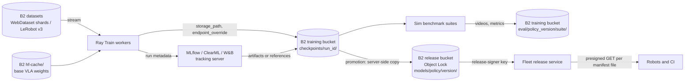

# Train and evaluate robot policies, checkpoint runs, and release models to the fleet

## Workload

Robot learning teams train visuomotor and vision-language-action (VLA) policies on multi-node GPU clusters that can be preempted. Checkpoints range from hundreds of MB to tens of GB and accumulate across runs. Candidates are evaluated in simulation benchmark suites. Promoted policies ship to robots and CI, and every release must trace back to its dataset version, code and eval results.

## Data flow



1. Trainers stream WebDataset shards or LeRobot v3 episodes from B2 (see [teleop-imitation-datasets](../teleop-imitation-datasets/architecture.md)).
2. Ray Train writes checkpoints to `checkpoints/<run_id>/` and resumes from the latest after preemption. `CheckpointConfig(num_to_keep=K)` prunes older checkpoints; B2 lifecycle cannot keep "the last K".
3. MLflow or ClearML records runs and artifacts; W&B reference artifacts record dataset and checkpoint lineage without copying bytes.
4. Candidates run benchmark suites; eval videos and metrics go to `eval/<policy_version>/<suite>/`.
5. A promotion job server-side copies the chosen checkpoint to `models/<policy>/<version>/` in an Object Lock bucket with retention set, plus a manifest with checksums, dataset version, commit and eval summary.
6. A fleet release service holds the only read key on `models/<policy>/` and mints short-lived presigned GETs for each file in the release manifest. Robots and CI download with those URLs and verify checksums before loading; they hold no B2 keys.

## B2 zones

| Zone | Bucket and prefix | Versioning and lifecycle | Object Lock | Purpose |
|---|---|---|---|---|
| Checkpoints | `<org>-robot-training/checkpoints/<run_id>/` | Purge hidden versions after a short window; delete abandoned runs ([lifecycle-scratch.json](../../examples/lifecycle-scratch.json)) | No | Resume state, pruned by the trainer |
| Eval artifacts | `<org>-robot-training/eval/<policy_version>/<suite>/` | Keep with the candidate's lifetime | No | Videos, metrics, rollouts |
| Tracking artifacts | `<org>-robot-training/mlflow/` or `clearml/` | Managed by the tracking server | No | Logged artifacts |
| Base model cache | `<org>-robot-training/hf-cache/` | Keep | No | Shared Hugging Face cache synced with [HF Cache Sync](https://github.com/backblaze-labs/hf-cache-sync) |
| Releases | `<org>-policy-releases/models/<policy>/<version>/` | Never overwritten | Yes, governance by default ([object-lock-evidence.json](../../examples/object-lock-evidence.json)) | Policies approved for the fleet |

## Boundaries

| Stays off B2 | Where it lives | Why |
|---|---|---|
| Tracking metadata databases | MLflow, ClearML or W&B backends | Transactional run and registry state |
| Metrics time series | Tracking server | High-frequency small writes |
| Eval leaderboard | Database | Queries and updates |
| Dataloader cache and checkpoint staging | GPU-node NVMe | Low-latency local I/O |
| Distributed training rendezvous | Ray head / torch.distributed | Live coordination |

## B2 capability map

| Capability | Used | How |
|---|---|---|
| S3-compatible API | Yes | Ray Train, MLflow, ClearML, W&B, trainers |
| Multipart upload | Yes | Multi-GB checkpoints |
| Server-side copy | Yes | Promote a checkpoint into the release bucket |
| Object Lock | Yes | Released policies |
| Presigned URLs | Yes | Release downloads for robots and CI, minted by the fleet release service |
| Scoped application keys | Yes | Trainers on `checkpoints/` and `eval/`; promotion alone writes `models/`; the fleet release service alone reads it |
| Lifecycle rules | Yes | Clean hidden versions and abandoned run prefixes |
| Event Notifications | Not used | Promotion is an explicit, reviewed step |
| Cloud Replication | Optional | DR copy of releases only; enable Object Lock on both buckets first |
| Overdrive vs local cache | Consider | [Overdrive](https://www.backblaze.com/cloud-storage/b2-overdrive) when many nodes read training data in parallel for sustained periods; NVMe staging for repeated epochs |

## Integration configuration

### Ray Train

Ray's persistent-storage guide has a Backblaze B2 section:

```python
from ray.train import RunConfig, CheckpointConfig
run_config = RunConfig(
    storage_path=f"s3://<org>-robot-training/checkpoints?endpoint_override=https://s3.{region}.backblazeb2.com",
    checkpoint_config=CheckpointConfig(num_to_keep=3),
)
```

Alternatively set the Arrow S3 environment variables and use a plain `s3://` path. The trainer key needs `deleteFiles` on `checkpoints/` because `num_to_keep` deletes older checkpoints. The [Ray Train/Tune checkpoints notebook](https://github.com/backblaze-b2-samples/notebooks/tree/main/ray-train-tune-checkpoints) shows this against B2.

### MLflow

MLflow documents a native `b2://` artifact URI: `b2://<bucket>@s3.<region>.backblazeb2.com/<path>`. Use it as the tracking server's artifact root; keep the backend store (database) off B2.

### Weights & Biases (reference artifacts)

The W&B reference-artifact documentation names Backblaze B2 and uses `AWS_S3_ENDPOINT_URL=https://s3.<region>.backblazeb2.com`. Reference artifacts record object URIs and checksums without uploading bytes, which suits multi-GB checkpoints and datasets that already live in B2.

### ClearML

ClearML's storage docs configure non-AWS endpoints in `sdk.aws.s3.credentials` with `host: "s3.<region>.backblazeb2.com:443"` and `secure: true`. The port is required.

## Security

- Training keys cover `checkpoints/` and `eval/` only and cannot write `models/`.
- The promotion job uses a short-lived key that can read the training bucket and write the release bucket with `writeFileRetentions` (see [examples](../../examples/README.md#scoped-application-keys)).
- Robots and CI hold no B2 keys. The fleet release service holds a `release-signer` key restricted to `models/<policy>/` with `listFiles,readFiles`, authorizes each robot or CI job, and returns presigned GETs that expire shortly after the expected download window (at most 7 days for SigV4). Robots verify manifest checksums before loading a policy.
- Use governance-mode Object Lock by default; compliance mode cannot be shortened or removed.
- Tracking servers store B2 credentials; restrict who can change their artifact configuration.

## References

- [Ray Train persistent storage](https://docs.ray.io/en/latest/train/user-guides/persistent-storage.html)
- [MLflow artifact stores: Backblaze B2](https://mlflow.org/docs/latest/self-hosting/architecture/artifact-store/#backblaze-b2)
- [W&B: track external files](https://docs.coreweave.com/guides/artifacts/track-external-files)
- [ClearML storage](https://clear.ml/docs/latest/docs/integrations/storage/)
- [WebDataset Streaming PyTorch Training](https://github.com/backblaze-b2-samples/webdataset-streaming-pytorch-training)
- [B2 Object Lock](https://www.backblaze.com/docs/cloud-storage-object-lock)
- [B2 pricing](https://www.backblaze.com/cloud-storage/pricing)
