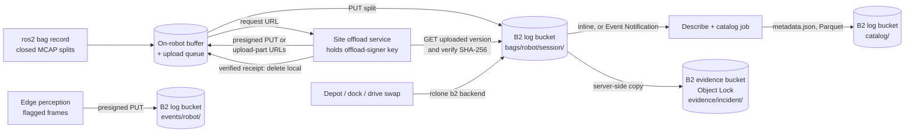
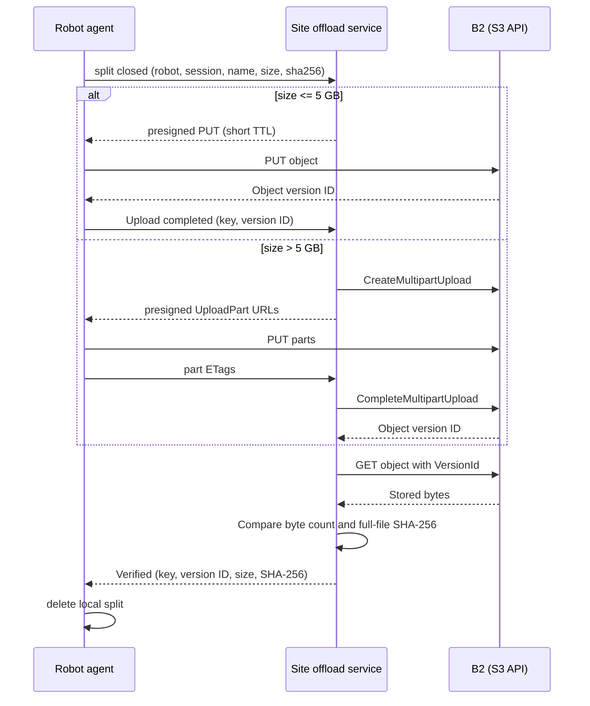

# Offload robot logs from the fleet into a raw log lake

## Workload

Robots record ROS 2 topics with `ros2 bag record` into split rosbag2 files (MCAP by default in current ROS 2 distributions), capped by duration or size. Size the local buffer from recording rate, offline duration, and the site offload window. Engineers need every session to land in durable storage with enough metadata to find it later, and they need incident windows preserved unchanged for safety review.

B2 is the raw log lake and the evidence store. The robot keeps only a bounded buffer and an upload queue; it never holds a B2 application key.

## Data flow

Object names are derived from robot, session, and split name. A retry can create a new B2 version; the `bags/` lifecycle rule purges superseded versions after its retention window. The offload service reads the exact uploaded version and compares its byte count and full-file SHA-256 with the closed split. It returns a receipt containing the key, version ID, size, and verified digest before the robot removes its local copy. Reuse a receipt only when the source digest and stored version match; size alone is insufficient. A single presigned PUT is limited to 5 GB, so larger splits use presigned upload-part URLs.

## B2 zones

| Zone | Bucket and prefix | Versioning and lifecycle | Object Lock | Purpose |
|---|---|---|---|---|
| Raw splits | `<org>-robot-logs/bags/<robot>/<session>/` | Hide after the retention window, delete hidden versions after a grace period ([lifecycle-log-lake.json](../../examples/lifecycle-log-lake.json)) | No | Every recorded split, as written by rosbag2, plus its `metadata.yaml` |
| Session catalog | `<org>-robot-logs/catalog/` | Keep current; hidden versions purge after the grace period | No | Per-session `metadata.json` and the rolled Parquet catalog |
| Edge events | `<org>-robot-logs/events/<robot>/` | Shorter retention than raw splits | No | Flagged frames and prediction JSON used as triage signals |
| Evidence | `<org>-robot-evidence/evidence/<incident_id>/` | Lifecycle does not remove versions under retention or legal hold | Yes, governance by default ([object-lock-evidence.json](../../examples/object-lock-evidence.json)) | Server-side copies of incident windows plus a SHA-256 manifest |

Evidence is a separate bucket because Object Lock, default retention and lifecycle are bucket-level controls; keeping it apart stops a raw-log retention change from touching evidence. The bucket names are placeholders: B2 bucket names are globally unique.

## Boundaries

| Stays off B2 | Where it lives | Why |
|---|---|---|
| Live ROS graph and topic transport | DDS on the robot | Real-time messaging, not objects |
| Partially written splits and the on-robot buffer | Robot SSD | A split becomes an object only once it is closed |
| Upload queue and dedupe state | Robot-local database or file | Must survive reboots and link loss without a network round trip |
| Incident case management | Ticketing or safety system | Transactional records; it links to evidence keys |

## B2 capability map

| Capability | Used | How |
|---|---|---|
| S3-compatible API | Yes | All reads and writes; endpoint `https://s3.<region>.backblazeb2.com` from the bucket region |
| Presigned URLs | Yes | Presigned PUT and presigned UploadPart for robot uploads |
| Multipart upload | Yes | Splits over 5 GB and rclone large-file transfers |
| Scoped application keys | Yes | One bucket and one prefix per key; robots get URLs, not keys |
| Event Notifications | Optional | `b2:ObjectCreated:*` on `bags/` triggers describe; Backblaze Support must enable the feature ([event-notifications.json](../../examples/event-notifications.json)) |
| Object versions and lifecycle | Yes | Hide then delete raw splits and edge events by age |
| Object Lock | Yes | Evidence bucket only; retention or legal hold per incident |
| Server-side copy | Yes | CopyObject, or UploadPartCopy for objects over 5 GB, into the evidence bucket |
| SSE-B2 / SSE-C | Not required | Enable SSE-B2 default encryption if policy requires encryption at rest beyond B2 defaults |
| Cloud Replication | Not used | Bucket-to-bucket DR only; see the ordering caveat in [examples](../../examples/README.md#object-lock-and-replication) |
| CORS | Not used here | Only needed for browser viewers, covered in [fleet-search-replay](../fleet-search-replay/architecture.md) |
| Overdrive | Not needed | Upload rate is bounded by site uplinks; Standard B2 is the default |

## Integration configuration

### ROS 2 rosbag2

rosbag2 writes bag files to local disk; [split them by size or duration](https://github.com/ros2/rosbag2#splitting-files-during-recording) (`ros2 bag record -s mcap -d <seconds>`) so each split closes and uploads independently. The [Rosbag2 Cloud Offload](https://github.com/backblaze-b2-samples/rosbag2-cloud-offload) sample demonstrates presigned-PUT offload, session metadata, Parquet cataloging, and presigned replay. Apply the version-specific checksum and acknowledgment requirements in the data flow above to local cleanup.

- Endpoint: derive `https://s3.<region>.backblazeb2.com` from `B2_REGION`; never hardcode it.
- Keys: the site service holds `offload-signer` (`listFiles,readFiles,writeFiles` on `bags/`) and `catalog-writer` (on `catalog/`). See [scoped keys](../../examples/README.md#scoped-application-keys).
- Use presigned upload-part URLs for splits over 5 GB, Event Notifications for the describe step, and a separate Object Lock bucket for evidence.

### rclone

The [rclone B2 backend](https://rclone.org/b2/) is a native B2 option for depots, docking stations and drive-swap ingest. Tune `--b2-chunk-size` and `--b2-upload-concurrency` for large splits. Give rclone its own key restricted to `bags/`. Use `rclone copy` from a staging directory populated only after the recorder closes each split; delete the local file after the offload service returns its checksum-verification receipt.

### Edge-triggered capture

The [Roboflow Inference Frame Archive](https://github.com/backblaze-b2-samples/roboflow-inference-frame-archive) sample shows the pattern for uploading only flagged frames, their prediction JSON, and Parquet roll-ups instead of continuous video. Here those objects go under `events/<robot>/` and serve as pointers into the raw splits.

## Security

- Robots hold no B2 keys. A compromised robot can write only the object names it was given URLs for, and only until those URLs expire.
- Keep presigned URL TTLs short and log every signing request with robot ID and key.
- The evidence writer is the only role with `writeFileRetentions` and `writeFileLegalHolds`; promotion across buckets uses a short-lived key covering both buckets (see [examples](../../examples/README.md#scoped-application-keys)).
- Use governance-mode Object Lock by default. Compliance mode cannot be shortened or removed, even by the account owner.
- Record a SHA-256 manifest with each evidence copy so later reviewers can verify bytes independently of B2.
- Secrets go in a gitignored `0600` `.env` or a secret manager; never print or log keys.

## References

- [ROS 2 rosbag2](https://github.com/ros2/rosbag2)
- [Rosbag2 Cloud Offload architecture](https://github.com/backblaze-b2-samples/rosbag2-cloud-offload/blob/main/ARCHITECTURE.md)
- [rclone B2 backend](https://rclone.org/b2/)
- [B2 S3-compatible API](https://www.backblaze.com/docs/cloud-storage-s3-compatible-api)
- [B2 Event Notifications](https://www.backblaze.com/docs/cloud-storage-event-notifications)
- [B2 Object Lock](https://www.backblaze.com/docs/cloud-storage-object-lock)
- [B2 lifecycle rules](https://www.backblaze.com/docs/cloud-storage-lifecycle-rules)
- [B2 pricing](https://www.backblaze.com/cloud-storage/pricing)
