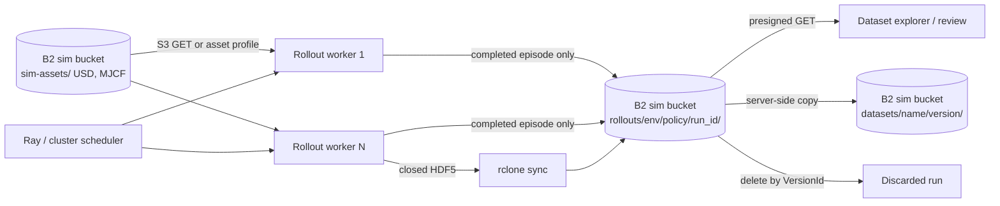

# Generate simulation rollouts and synthetic demonstrations at scale

## Workload

Simulation teams run policy sweeps, domain randomization and synthetic demonstration generation across many GPU workers. Each sweep loads the same robot and scene assets and produces many episodes: rendered video, per-step state, action and reward arrays, and a summary. Some runs are scratch; good ones become training data for behavioral cloning, offline RL or evaluation baselines. There is no shared filesystem across the farm.

## Data flow



Each worker writes an episode only after it completes:

```
rollouts/<env>/<policy>/<run_id>/
  config.json                         # simulator, asset version, seed, policy checkpoint
  episode-<n>/video.mp4
  episode-<n>/states.npy
  episode-<n>/actions.npy
  episode-<n>/rewards.npy
  episode-<n>/summary.json
```

A retry writes the same keys again, so reruns stay inside their run prefix; on B2 each rewrite adds a new version and hides the previous one. Promotion copies a run into `datasets/<name>/<version>/` with server-side copy, so bytes do not leave B2. On B2, `DeleteObjects` without a `VersionId` only hides each file; the bytes stay stored. To remove them, list the prefix with `ListObjectVersions` and delete by `VersionId` (needs `deleteFiles`), or rely on the `daysFromHidingToDeleting` rule in [lifecycle-scratch.json](../../examples/lifecycle-scratch.json), which purges hidden versions under `rollouts/` after a short grace period.

## B2 zones

| Zone | Bucket and prefix | Versioning and lifecycle | Object Lock | Purpose |
|---|---|---|---|---|
| Sim assets | `<org>-robot-sim/sim-assets/<asset>/<version>/` | Keep; new versions under new prefixes | No | Read-mostly USD, MJCF, meshes, textures |
| Scratch sweeps | `<org>-robot-sim/rollouts/scratch/` | Hide after a short window, then delete ([lifecycle-scratch.json](../../examples/lifecycle-scratch.json)) | No | Exploratory runs |
| Runs | `<org>-robot-sim/rollouts/<env>/<policy>/<run_id>/` | Keep until promoted or discarded; hidden versions purge after a grace period | No | Append-only episode outputs |
| Datasets | `<org>-robot-sim/datasets/<name>/<version>/` | Never overwritten | Optional, in a separate locked bucket | Promoted runs used for training |

## Boundaries

| Stays off B2 | Where it lives | Why |
|---|---|---|
| Simulator and GPU state | Worker memory | Per-step state, not objects |
| Partially written HDF5 or episode buffers | Worker local disk | HDF5 updates in place; upload only closed files |
| Ray object store | Node memory | Inter-task data plane |
| Scheduler and job queue | Ray head / cluster scheduler | Transactional |
| USD live-edit sessions | Nucleus or a local workspace | Live collaborative editing is not object storage |

## B2 capability map

| Capability | Used | How |
|---|---|---|
| S3-compatible API | Yes | Asset reads and episode writes |
| Presigned URLs | Yes | GET for explorers and review |
| Multipart upload | Yes | Large videos and HDF5 files |
| Server-side copy | Yes | Promote a run to a dataset version |
| Version-aware deletes | Yes | `ListObjectVersions` plus `DeleteObjects` by `VersionId` for discarded runs |
| Lifecycle rules | Yes | Expire scratch sweeps (hide, then delete); purge hidden versions under `rollouts/` |
| Scoped application keys | Yes | Workers write only `rollouts/`; assets read-only |
| Event Notifications | Not used | The scheduler already knows when a run finishes |
| Object Lock | Optional | Only for locked dataset releases in a separate bucket |
| Overdrive | Consider | When sustained sweep reads or writes saturate Standard throughput |
| Local cache | Yes | Cache sim assets on each node; they are reread every episode |

## Integration configuration

### MuJoCo Playground

MuJoCo Playground rollouts run in Python; write each finished episode to a local run directory and sync closed episodes to `rollouts/<env>/<policy>/<run_id>/` with rclone or s5cmd, or write directly with boto3. The [MuJoCo Rollout Dataset](https://github.com/backblaze-b2-samples/mujoco-rollout-dataset) sample rolls out MuJoCo Playground policies, renders each episode, and writes MP4, `.npy` arrays and JSON under a rollout prefix with boto3 against `https://s3.<region>.backblazeb2.com`. It serves presigned GETs for review and deletes by prefix; pass `VersionId` when deleting, since a plain delete only hides files on B2.

### NVIDIA Isaac Sim (asset region profiles)

Isaac Sim's `isaacsim.storage.native` extension documents an `asset_region_profiles` setting with an S3-compatible endpoint, bucket and region, applied in memory. Point the endpoint at `https://s3.<region>.backblazeb2.com`, set the bucket and region, select the profile with `ISAACSIM_ASSET_REGION_PROFILE`, and supply credentials from the environment. Use it to load USD assets from `sim-assets/`. Isaac Lab and Isaac Lab Mimic write outputs to local paths; close those files and sync them with rclone.

### rclone

Use the [rclone B2 backend](https://rclone.org/b2/) to sync closed HDF5 files and run directories from workers or a shared staging disk. Give it a key restricted to `rollouts/`.

### Mounting assets in Kubernetes

Jobs that expect file paths can mount `sim-assets/` read-only with the Mountpoint for Amazon S3 CSI driver, as shown in the [B2 Mountpoint CSI sample](https://github.com/backblaze-b2-samples/b2-integration-mountpoint-csi). Do not mount the rollout prefix for in-place writes.

## Security

- Workers hold a writer key restricted to `rollouts/` and a read-only key for `sim-assets/`.
- Promotion and discarding use a separate operator key with `deleteFiles`; workers cannot delete.
- Isaac Sim settings files must not contain credentials; inject them at runtime.
- Record simulator version, asset version, seed and checkpoint in `config.json` so results are reproducible and asset licenses are traceable.

## References

- [MuJoCo Playground](https://playground.mujoco.org/)
- [MuJoCo Rollout Dataset architecture](https://github.com/backblaze-b2-samples/mujoco-rollout-dataset/blob/main/ARCHITECTURE.md)
- [Isaac Sim](https://developer.nvidia.com/isaac/sim) and its [storage settings](https://docs.isaacsim.omniverse.nvidia.com/6.1.0/py/source/extensions/isaacsim.storage.native/docs/SETTINGS.html)
- [rclone B2 backend](https://rclone.org/b2/)
- [B2 lifecycle rules](https://www.backblaze.com/docs/cloud-storage-lifecycle-rules)
- [B2 Overdrive](https://www.backblaze.com/cloud-storage/b2-overdrive)
