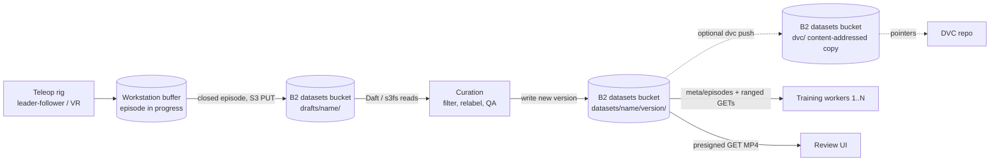
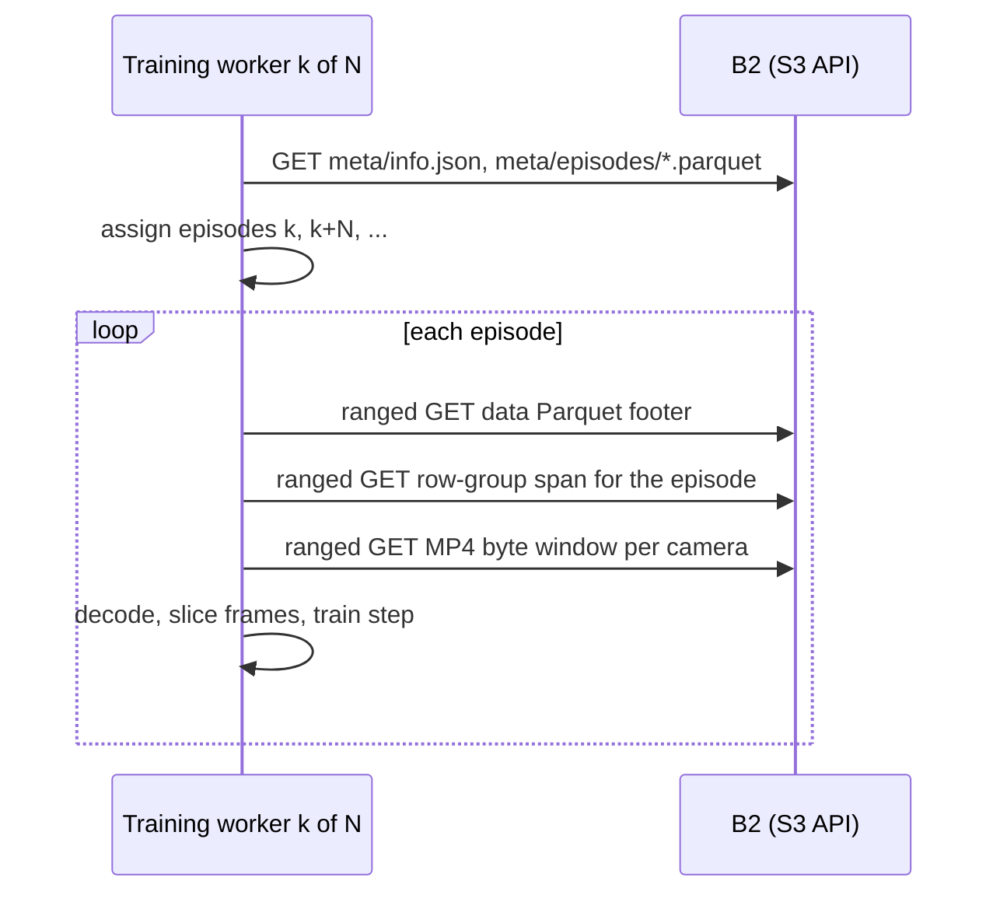

# Record teleoperation demonstrations and stream imitation-learning datasets

## Workload

Imitation-learning teams collect demonstrations with leader-follower arms, VR or spacemouse teleoperation. Each episode is multi-camera video plus per-step state and action. Datasets reach TB scale and are read many times by many training workers. Released versions must stay byte-identical so a trained policy can be traced to exactly the data it saw.

## Data flow





## Dataset layout

The LeRobot v3 format stores many episodes per shard and indexes them in `meta/episodes/`:

```
datasets/<name>/<version>/
  meta/info.json
  meta/stats.json
  meta/tasks.parquet
  meta/episodes/chunk-000/file-000.parquet   # per-episode frame and byte offsets
  data/chunk-000/file-000.parquet            # state and action rows
  videos/<camera>/chunk-000/file-000.mp4     # many episodes per shard
```

The `meta/episodes` rows carry frame ranges, shard indexes and per-video timestamps. These offsets let a reader plan ranged GETs for one episode without downloading whole shards. The sample stores one v3 tree per episode under `lerobot/episodes/ep_<n>/` to make deletes prefix-scoped; this architecture recommends one tree per released version instead, so a version is a single immutable prefix. Zarr replay buffers (diffusion policy, UMI) follow the same rule: `datasets/<name>/<version>/replay.zarr/`.

## B2 zones

| Zone | Bucket and prefix | Versioning and lifecycle | Object Lock | Purpose |
|---|---|---|---|---|
| Draft episodes | `<org>-robot-datasets/drafts/<name>/` | Hide after the promotion window, then delete ([lifecycle-scratch.json](../../examples/lifecycle-scratch.json)) | No | Newly recorded episodes awaiting curation |
| Released versions | `<org>-robot-datasets/datasets/<name>/<version>/` | Never overwritten; no lifecycle rule | Optional, governance | Frozen dataset versions read by trainers |
| DVC remote (optional) | `<org>-robot-datasets/dvc/` | Content-addressed; keep | No | A second copy of each tracked file, stored by content hash |

Drafts live under a top-level `drafts/` prefix, not inside `datasets/`, so the recorder's prefix-restricted key cannot reach released versions even without Object Lock. If released versions must be locked, use a separate bucket with Object Lock enabled so draft deletes are unaffected.

## Boundaries

| Stays off B2 | Where it lives | Why |
|---|---|---|
| In-progress episode | Teleop workstation disk | Written frame by frame until closed |
| Task, label and curation queue | Application database | Transactional updates |
| DVC git repo | Git host | Holds pointers, not data |
| Hub mirror (optional) | Hugging Face Hub | Public or partner sharing; not the system of record here |

## B2 capability map

| Capability | Used | How |
|---|---|---|
| S3-compatible API | Yes | Recording writes, curation reads, training reads |
| Range GET | Yes | Parquet row groups and MP4 byte windows per episode |
| Presigned URLs | Yes | GET for review UIs |
| Scoped application keys | Yes | Recorder restricted to `drafts/<name>/`; curation writes `datasets/<name>/`; trainers read-only on one version prefix ([keys](../../examples/README.md#scoped-application-keys)) |
| Object Lock | Optional | Lock released versions in a dedicated bucket |
| Included egress | Yes | Multi-epoch streaming by many workers; see [B2 pricing](https://www.backblaze.com/cloud-storage/pricing) |
| Multipart upload | As needed | Large MP4 shards from the SDK's upload path |
| Event Notifications | Not used | Curation is batch |
| Overdrive vs local cache | Consider | [Overdrive](https://www.backblaze.com/cloud-storage/b2-overdrive) for sustained multi-node streaming; local NVMe cache for repeated epochs of one version |

## Integration configuration

### Hugging Face LeRobot

LeRobot [records and loads v3 datasets](https://huggingface.co/docs/lerobot/lerobot-dataset-v3) from a local root. Call `dataset.finalize()`, then sync the dataset directory to `datasets/<name>/<version>/` with rclone or s5cmd; trainers sync a version back to their local root and load it with `LeRobotDataset(repo_id, root=...)`. To stream without a local copy, use the [LeRobot B2 Streaming](https://github.com/backblaze-b2-samples/lerobot-b2-streaming) sample: boto3 against `https://s3.<region>.backblazeb2.com` reads the data Parquet footer with a small ranged GET, fetches only the episode's row-group span, ranges the camera MP4 byte window, and decodes frames with torchcodec. It splits episodes across N workers.

### Daft

Daft documents `daft.datasets.lerobot.read` and S3 `IOConfig` with a custom endpoint:

```python
import daft
from daft.io import IOConfig, S3Config
io = IOConfig(s3=S3Config(endpoint_url=f"https://s3.{region}.backblazeb2.com",
                          key_id=key_id, access_key=app_key))
df = daft.datasets.lerobot.read("s3://<org>-robot-datasets/datasets/<name>/<version>", io_config=io)
```

Use it for lazy filtering, relabeling and quality checks; write results to a new version prefix.

### Zarr via s3fs

Zarr reaches B2 through fsspec. s3fs documents an `endpoint_url` argument: `s3fs.S3FileSystem(endpoint_url=f"https://s3.{region}.backblazeb2.com")` (`client_kwargs={"endpoint_url": ...}` also works). Write Zarr stores once and treat them as read-only after release. Zarr's in-place chunk updates are fine on a draft prefix but must not touch a released version.

### DVC

```bash
dvc remote add -d b2 s3://<org>-robot-datasets/dvc
dvc remote modify b2 endpointurl https://s3.<region>.backblazeb2.com
dvc remote modify --local b2 access_key_id "$B2_APPLICATION_KEY_ID"
dvc remote modify --local b2 secret_access_key "$B2_APPLICATION_KEY"
```

`--local` keeps credentials in `.dvc/config.local`, which DVC does not commit.

`dvc push` uploads a second, content-addressed copy of each tracked file under `dvc/`; it does not point at the objects under `datasets/<name>/<version>/`. Either make DVC the system of record for released versions and skip the version-prefix copy, or skip DVC and pin versions by prefix. Storing both doubles the bytes. `dvc import-url` can reference external objects without copying them.

## Security

- The recording workstation writes only `drafts/<name>/` with the `recorder-writer` key; curation reads drafts and writes a new version prefix; trainers read one released prefix.
- Review UIs get short-lived presigned GETs.
- Teleop video can capture operators and bystanders. Record consent and redaction status in the dataset card.
- Never print keys; keep them in a gitignored `0600` `.env` or a secret manager.

## References

- [LeRobot](https://github.com/huggingface/lerobot)
- [LeRobot B2 Streaming architecture](https://github.com/backblaze-b2-samples/lerobot-b2-streaming/blob/main/ARCHITECTURE.md)
- [Daft LeRobot reader](https://docs.daft.ai/en/stable/datasets/lerobot/)
- [Daft IOConfig](https://docs.daft.ai/en/stable/api/config/)
- [Zarr](https://zarr.dev/) and [s3fs](https://s3fs.readthedocs.io/en/latest/)
- [DVC Amazon S3 remote](https://doc.dvc.org/user-guide/data-management/remote-storage/amazon-s3)
- [B2 S3-compatible API](https://www.backblaze.com/docs/cloud-storage-s3-compatible-api)
